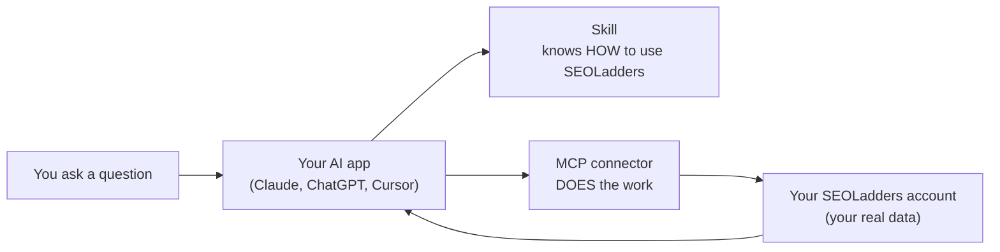
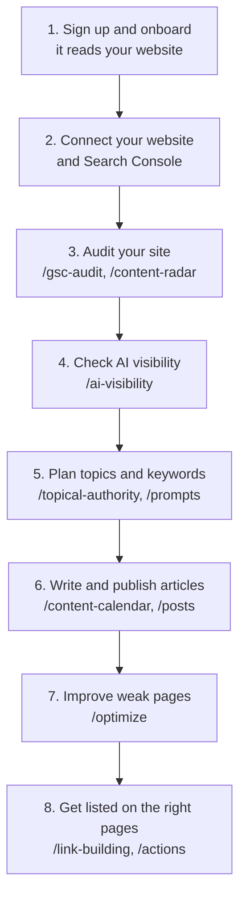

# SEOLadders for Claude, ChatGPT and Cursor

**Your SEOLadders dashboard, inside the AI app you already use.**

Ask in plain English, and get answers from your own SEOLadders account:

> *"Who does ChatGPT recommend instead of me?"*
> *"Which of my pages are losing traffic?"*
> *"What is my agent writing this week?"*

It uses the same data as your dashboard and the same plan allowances, so nothing costs more in chat than in the app.

---

## Contents

1. [How it works](#how-it-works)
2. [Before you start](#before-you-start)
3. [Set it up](#set-it-up) (pick your app)
4. [Try it](#try-it)
5. [Something not working?](#something-not-working)
6. [Everything you can ask for](#everything-you-can-ask-for)
7. [How SEOLadders works](#how-seoladders-works)
8. [Plans](#plans)
9. [For developers](#for-developers)

---

## How it works

You add **two things** to your AI app. Each does a different job.



| | What it is | Without it |
|---|---|---|
| **Skill** | The instructions. It teaches your AI app how SEOLadders works and which command to use when. | Your AI app has the tools but guesses how to use them. |
| **MCP connector** | The connection. It lets your AI app read your data and take actions in your account. | Your AI app knows the steps but can't run any of them. |

**Add both.** The setup below walks you through each one.

---

## Before you start

You need two things:

1. **A SEOLadders account.** Sign up at [seoladders.com](https://www.seoladders.com) and finish onboarding. There's a 7-day free trial, and your first month is 50% off.
2. **Your website and Google Search Console connected** in the dashboard. Many answers (audits, rankings, pages losing traffic) come from Search Console, so connect it first.

> **Do I need an API key?**
> Only if you use **Claude Code, Cursor, Windsurf, Codex, ChatGPT or the terminal**. The **Claude app** signs you in instead, so there's no key to copy.
>
> To create a key: in your dashboard, open the **MCP & Skill** page (`/dashboard/developers`). Your key starts with `sk_live_` and is **shown only once**, so save it somewhere safe.

---

## Set it up

Pick the app you use:

| I use... | Go to |
|---|---|
| **Claude app** (claude.ai, web or desktop) | [Claude app setup](#claude-app) |
| **Claude Code, Cursor, Windsurf or Codex** | [Code editor setup](#claude-code-cursor-windsurf-or-codex) |
| **ChatGPT** | [ChatGPT setup](#chatgpt) |
| **The terminal, or another AI tool** | [Terminal setup](#terminal-or-another-ai-tool) |

<br/>

### Claude app

Three steps: add the skill, add the connector, then check it works.

#### Step 1. Add the skill

The Claude app takes skills as a `.zip` file. Pick **one** of these ways to get it.

**Way A: ask Claude to make the zip (easiest)**

Paste this into any Claude chat:

```
Package the skill at https://github.com/Kwesi-dev/seo-ladders-skill.git into a zip I can upload: the seoladders folder, with SKILL.md at its root.
```

Claude hands you back a file to download.

**Way B: make the zip yourself**

1. On this page, click the green **Code** button, then **Download ZIP**, and unzip it.
2. Inside, find the folder called **`seoladders`**.
3. Zip **only that folder**:
   - **Mac:** right-click `seoladders`, then **Compress "seoladders"**.
   - **Windows:** right-click `seoladders`, then **Send to**, then **Compressed (zipped) folder**.

> ⚠️ **Zip the `seoladders` folder, not the whole download.** If you upload the zip GitHub gave you, Claude shows the error *"SKILL.md file must be in the top-level folder"*.

**Then upload it:**

1. In Claude, go to **Customize → Skills → +**.
   (On some versions: **Settings → Capabilities → Skills → Upload skill**.)
2. Choose your `seoladders.zip`.
3. It appears under **Personal skills**.

#### Step 2. Add the connector

1. Go to **Customize → Connectors → + → Add custom connector**.
2. Fill it in like this:

| Field | What to enter |
|---|---|
| **Name** | `SEOLadders` |
| **URL** | `https://www.seoladders.com/api/mcp` |
| **Authentication** | **Sign in now** (Claude marks it *Detected*) |
| **OAuth client** | **Register automatically** (Claude marks it *Detected*) |
| **Request headers** | Leave empty |

3. Click **Add**, then **Connect**.
4. A SEOLadders sign-in window opens. Sign in (you get the usual email link) and approve access.

That's it. No API key is needed in the Claude app.

#### Step 3. Check it works

Start a new chat and ask:

```
Use SEOLadders to show me my AI visibility.
```

When Claude asks for permission to use SEOLadders, choose **Allow**. You should see your score and the AI engines that mention you.

<br/>

### Claude Code, Cursor, Windsurf or Codex

#### Step 1. Get your API key

Create one on the **MCP & Skill** page in your dashboard (see [Before you start](#before-you-start)).

#### Step 2. Install the skill

Run this in your terminal:

```bash
npx skills add Kwesi-dev/seo-ladders-skill/seoladders
```

#### Step 3. Add the connector

Add this to your app's MCP settings. Replace `sk_live_...` with your key.

```json
{
  "mcpServers": {
    "seoladders": {
      "type": "http",
      "url": "https://www.seoladders.com/api/mcp",
      "headers": { "Authorization": "Bearer sk_live_..." }
    }
  }
}
```

#### Step 4. Check it works

Type `/seoladders-setup`. It confirms your key works and shows what's connected.

<br/>

### ChatGPT

ChatGPT connects through a **Custom GPT** that you make once.

1. In ChatGPT, go to **Create a GPT → Configure → Actions → Import from URL** and enter:
   `https://www.seoladders.com/api/openapi.json`
2. Under **Authentication**, choose **API Key**, then **Bearer**, and paste your `sk_live_...` key.
3. Open [`seoladders/SKILL.md`](seoladders/SKILL.md), copy all of it, and paste it into the GPT's **Instructions** box. (This is the skill.)
4. Save, then ask: *"Check my AI visibility."*

> **Keep your GPT private.** A shared GPT uses your key for everyone who opens it, so each person should make their own GPT with their own key. On ChatGPT Pro or Business, you can instead add `https://www.seoladders.com/api/mcp` as a custom connector.

<br/>

### Terminal or another AI tool

Save your key:

```bash
export SEO_LADDERS_API_KEY=sk_live_...
```

Then use the commands in [For developers](#for-developers). They need `curl` and `jq`.

---

## Try it

Good first questions:

| Ask | What you get |
|---|---|
| *"Show me my AI visibility."* | Your score, and which AI engines mention you |
| *"Who does ChatGPT recommend instead of me?"* | The competitors named in your place |
| *"Which pages does AI cite for my questions?"* | The websites AI trusts for your topic |
| *"Show me the outreach emails waiting for me."* | Emails already written for you to send |
| *"Which of my pages are losing traffic?"* | Pages to refresh, from your Search Console |
| *"What is my agent writing this week?"* | Your upcoming articles |

You can also type a command directly, like `/ai-visibility`. See the [full list](#everything-you-can-ask-for).

---

## Something not working?

| What you see | What to do |
|---|---|
| *"SKILL.md file must be in the top-level folder"* when uploading | You zipped the whole download. Zip only the `seoladders` folder ([Step 1](#step-1-add-the-skill)). |
| The Claude connector doesn't open a sign-in window, or nothing happens | Remove the connector and add it again. |
| **401** or *"unauthorized"* | Your key is wrong or missing. Copy it again, or create a new one on the **MCP & Skill** page. |
| **402** or *"subscription required"* | Your trial or plan has ended. Start one from the link in the message. |
| *"gsc_not_connected"* | Connect Google Search Console in your dashboard. |
| Commands like `/ai-visibility` don't show up in Claude Code | Run `/seoladders-setup`, or copy the files in `seoladders/commands/` into your project's `.claude/commands/` folder. |

Still stuck? Ask in the [Discord](https://discord.gg/2xfNfCPAHZ).

---

## Everything you can ask for

You don't need to remember these: asking in plain English works. In some apps the commands appear as `/seoladders:<name>` (for example `/seoladders:ai-visibility`). Both work the same.

Most commands only read what your agent already collected and are **free**. Commands marked **metered** use part of your monthly allowance.

Click a group to open it.

<details>
<summary><b>Start here</b></summary>

| Command | What it does |
|---|---|
| `/seoladders` | A quick tour: your account and how SEOLadders works |
| `/seoladders-setup` | Checks your setup and what's connected (website, Search Console, Analytics), and lists your sites |
| `/overview` | Your dashboard home: wins, AI visibility, search clicks, articles, audit and recent activity |
| `/usage` | What's left of this month's allowances |
| `/settings` | Whether autofill and auto-publish are on |

</details>

<details>
<summary><b>AI search (ChatGPT, Perplexity, Gemini, Claude, Google AI)</b></summary>

| Command | What it does |
|---|---|
| `/ai-visibility` | Your AI visibility score on each engine, plus the sources AI cites and how it talks about you |
| `/content-gaps` | Questions where AI names someone else and not you, so you know what to write |
| `/prompts` | The questions your agent asks AI for you. See them, add new ones, or swap them |
| `/competitors` | The competitors you're compared with in AI answers (10 on Pro, 5 on the trial) |

</details>

<details>
<summary><b>Google search</b></summary>

| Command | What it does |
|---|---|
| `/search-console` | Your Google Search Console data: any query, page or date range |
| `/analytics` | Your Google Analytics data, including visits from AI assistants |
| `/gsc-audit` | Your weekly site audit: health score and every issue, with what to do |
| `/content-radar` | Pages that are losing traffic, stuck on page 2, or hard to find |
| `/indexing` | Which of your pages Google knows about (limited checks) |
| `/rankings <domain>` | The keywords any website ranks for on Google |
| `/serp-check <keyword>` | Google's top 10 for a keyword, your rank, or what Google's AI cites (**metered**) |
| `/site-check <check>` | Page speed, AI readiness, llms.txt, sitemaps and E-E-A-T on your site |

</details>

<details>
<summary><b>Keywords and topics</b></summary>

| Command | What it does |
|---|---|
| `/my-keywords` | The keywords your agent already chose, by topic, and what's scheduled |
| `/topical-authority` | Your topic clusters, with their keywords and tracked questions |
| `/keyword-research [seed]` | New keyword ideas (**metered**, so check `/my-keywords` first) |
| `/keyword-lookup <keywords>` | Search volume, difficulty, cost per click and intent for keywords you have in mind (**metered**) |
| `/competitor-gap` | Keywords your competitors rank for and you don't |

</details>

<details>
<summary><b>Articles</b></summary>

| Command | What it does |
|---|---|
| `/write-article` | What your agent is writing and when, and today's article if you ask for it |
| `/content-calendar` | See and manage your scheduled articles |
| `/posts` | The articles already written and published |
| `/publish <article-id>` | Publish a finished draft to your website |
| `/optimize` | Rewrite a page that's stuck on page 2 or losing traffic |
| `/knowledge` | What your agent knows about your business. Read it, add a fact or correct it |
| `/brand-profile` | Your business details, audiences and the pages it links to |

</details>

<details>
<summary><b>Links and outreach</b></summary>

| Command | What it does |
|---|---|
| `/link-building` | Pages worth getting listed on: the ones AI cites, and the ones that link to your competitors but not you. Each comes with the author and an outreach email already written. You read it and send it yourself; nothing is sent for you. |
| `/actions` | Your to-do list: outreach, Reddit and content gaps |
| `/my-backlinks` | The links pointing to your site and where each came from |
| `/link-exchange` | Your Link Exchange membership, credits and the links placed for you |

</details>

---

## How SEOLadders works

Once you sign up, your agent works on its own. This is the order it follows, and the order the skill uses when it guides you:



**About publishing:** autofill and auto-publish are **on by default**. Auto-publish turns itself on when you connect your website. If you'd rather approve each article first, ask to turn auto-publish off.

The full first-run guide is in [`seoladders/references/onboarding-guide.md`](seoladders/references/onboarding-guide.md).

---

## Plans

| Plan | Price | What you get |
|---|---|---|
| **Free trial** | 7 days free | Everything in Pro |
| **Pro** | $97 a month per website, with **50% off your first month** | 30 articles a month, 30 tracked AI questions, 100 keyword searches a month, AI visibility, Content Radar, site audits and auto-publish |

The skill and MCP are included in Pro, not a paid add-on. Current prices: [seoladders.com/pricing](https://www.seoladders.com/pricing).

---

## For developers

<details>
<summary><b>Use the API directly with curl</b></summary>

<br/>

- **Base URL:** `https://www.seoladders.com/api/v1`
- **Auth:** send `Authorization: Bearer $SEO_LADDERS_API_KEY` on every call.
- **Pick a site:** add `?site=<domain>` or an `X-Site: <domain>` header. Without it, your active site is used.

```bash
# Your sites
curl -s -H "Authorization: Bearer $SEO_LADDERS_API_KEY" \
  https://www.seoladders.com/api/v1/projects | jq .

# AI visibility across engines (+ sub-views: citations, sentiment, sources)
curl -s -H "Authorization: Bearer $SEO_LADDERS_API_KEY" \
  https://www.seoladders.com/api/v1/ai-visibility | jq '{visibilityScore, perEngine, shareOfVoice}'
curl -s -H "Authorization: Bearer $SEO_LADDERS_API_KEY" \
  https://www.seoladders.com/api/v1/ai-visibility/content-gaps | jq '.gaps[]'   # AI content gaps

# Competitor gap: keywords competitors rank for that you don't
curl -s -X POST -H "Authorization: Bearer $SEO_LADDERS_API_KEY" -H "Content-Type: application/json" \
  -d '{"competitors":["competitor.com"]}' https://www.seoladders.com/api/v1/keywords/competitor-gap | jq '.keywords[]'

# Content Radar: pages losing traffic, quick wins, CTR problems (free)
curl -s -H "Authorization: Bearer $SEO_LADDERS_API_KEY" \
  https://www.seoladders.com/api/v1/content-radar | jq '.rows[] | {url, bucket, action}'

# Keyword research: manual seed, or find-for-me (empty body)
curl -s -X POST -H "Authorization: Bearer $SEO_LADDERS_API_KEY" -H "Content-Type: application/json" \
  -d '{"seed":"ai seo tools","filterByDR":true}' https://www.seoladders.com/api/v1/keywords/search | jq '.keywords[]'
curl -s -X POST -H "Authorization: Bearer $SEO_LADDERS_API_KEY" -H "Content-Type: application/json" \
  -d '{}' https://www.seoladders.com/api/v1/keywords/discover | jq '{seed, keywords}'

# The writing plan; POST writes today's scheduled article (only today's, one at a time)
curl -s -H "Authorization: Bearer $SEO_LADDERS_API_KEY" https://www.seoladders.com/api/v1/articles/today | jq '{plan, articles, today, upcoming}'

# What the agent already did: keywords, audit report, backlinks, dashboard overview (all free)
curl -s -H "Authorization: Bearer $SEO_LADDERS_API_KEY" https://www.seoladders.com/api/v1/keywords/found | jq '.summary'
curl -s -H "Authorization: Bearer $SEO_LADDERS_API_KEY" https://www.seoladders.com/api/v1/audit | jq '{audit, issues: .report.issues[:5]}'
curl -s -H "Authorization: Bearer $SEO_LADDERS_API_KEY" https://www.seoladders.com/api/v1/overview | jq '{wins, kpis}'

# Your Search Console and Analytics data, any query (free, cached)
curl -s -G -H "Authorization: Bearer $SEO_LADDERS_API_KEY" https://www.seoladders.com/api/v1/search-console \
  --data-urlencode 'dimensions=page,device' --data-urlencode 'days=28' | jq '.rows[:10]'
curl -s -G -H "Authorization: Bearer $SEO_LADDERS_API_KEY" https://www.seoladders.com/api/v1/analytics \
  --data-urlencode 'metrics=sessions,keyEvents' --data-urlencode 'dimensions=sessionDefaultChannelGroup' | jq '.rows'

# Calendar · actions
curl -s -H "Authorization: Bearer $SEO_LADDERS_API_KEY" https://www.seoladders.com/api/v1/calendar | jq '.entries[]'
curl -s -H "Authorization: Bearer $SEO_LADDERS_API_KEY" https://www.seoladders.com/api/v1/actions | jq '.actions[]'

# --- Automation (opt-in: CONFIRM with the user before enabling any of these) ---
# Publish one generated draft now (must be "ready") · autofill · auto-publish
curl -s -X POST -H "Authorization: Bearer $SEO_LADDERS_API_KEY" \
  https://www.seoladders.com/api/v1/articles/ARTICLE_ID/publish | jq '{published, url}'
curl -s -X POST -H "Authorization: Bearer $SEO_LADDERS_API_KEY" -H "Content-Type: application/json" \
  -d '{"enabled":true}' https://www.seoladders.com/api/v1/autoblog/autofill | jq '{autofill, message}'
curl -s -X POST -H "Authorization: Bearer $SEO_LADDERS_API_KEY" -H "Content-Type: application/json" \
  -d '{"enabled":true}' https://www.seoladders.com/api/v1/settings/auto-publish | jq '{autoPublish, message}'
```

Every command's full API call is in [`seoladders/SKILL.md`](seoladders/SKILL.md). The MCP connector has a tool for each one.

</details>

<details>
<summary><b>More about AI visibility</b></summary>

<br/>

Throughout the week, SEOLadders asks ChatGPT, Perplexity, Gemini, Claude, Google AI Overview and Google AI Mode the buyer questions you track. There are no manual runs on Pro, so there's nothing to start by hand. It then measures:

- **Visibility score**, and how often each engine mentions you
- **Share of voice:** you against each competitor (10 tracked on Pro, 5 on the trial)
- **Sentiment:** how positively AI describes you
- **Citations:** the sources AI pulls from. Pages marked `owned:false` are other sites worth getting listed on.
- **Content gaps:** questions where AI doesn't name you, so you know what to write next (`/content-gaps`)

Sub-views: `/ai-visibility/citations`, `/ai-visibility/content-gaps`, `/ai-visibility/sentiment`, `/ai-visibility/sources`. More in [`seoladders/references/ai-visibility-playbook.md`](seoladders/references/ai-visibility-playbook.md).

</details>

<details>
<summary><b>Reference guides in this repo</b></summary>

<br/>

- [`ai-visibility-playbook.md`](seoladders/references/ai-visibility-playbook.md): grow how AI recommends you
- [`audit-playbook.md`](seoladders/references/audit-playbook.md): the audit-first workflow
- [`onboarding-guide.md`](seoladders/references/onboarding-guide.md): first-run setup and API key
- [`plans-and-backlinks.md`](seoladders/references/plans-and-backlinks.md): plan details

</details>

---

## Community

Setup help, updates, and a place to share your wins: **[join the Discord](https://discord.gg/2xfNfCPAHZ)**.
